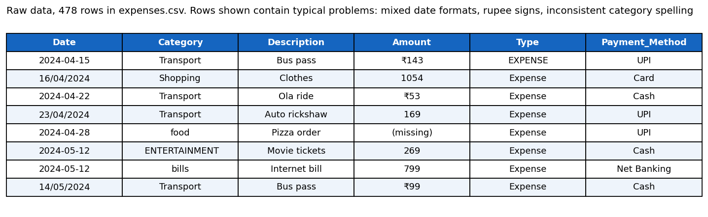
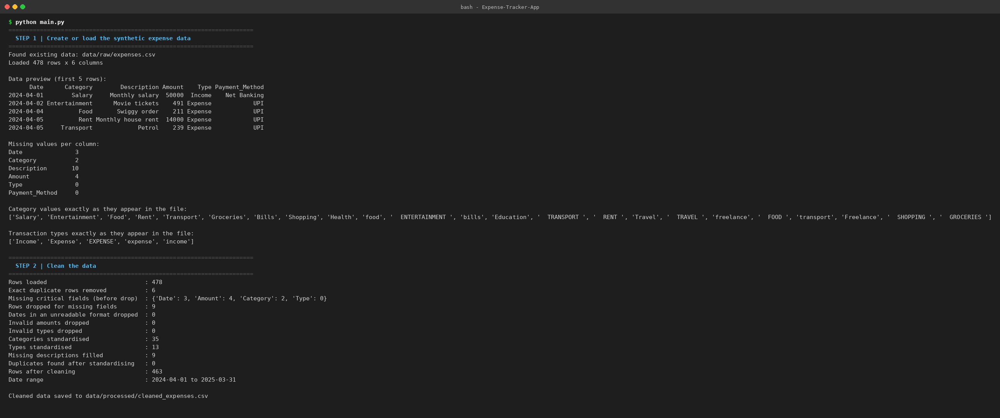
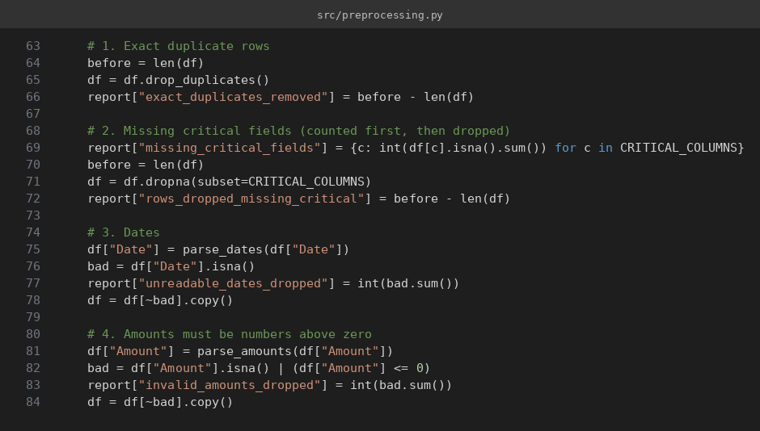
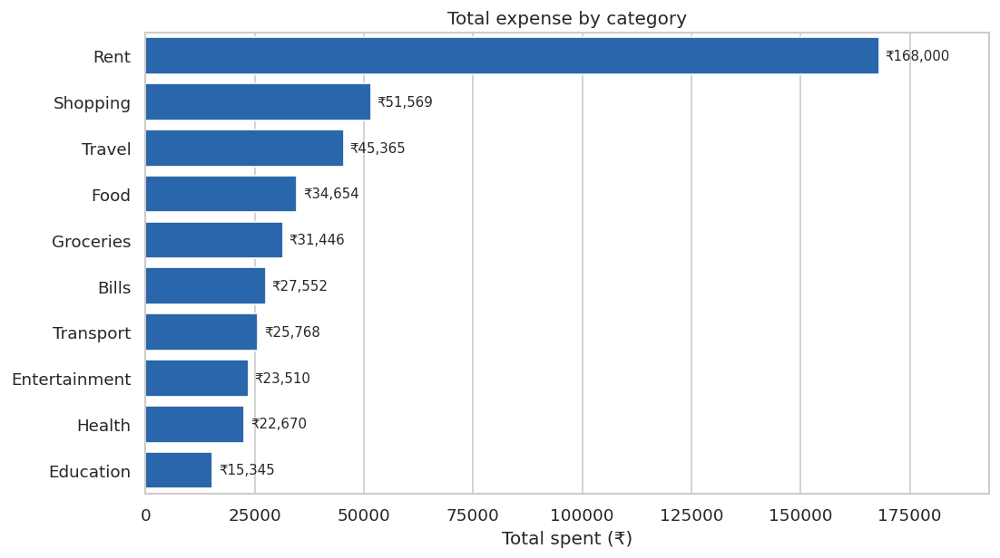
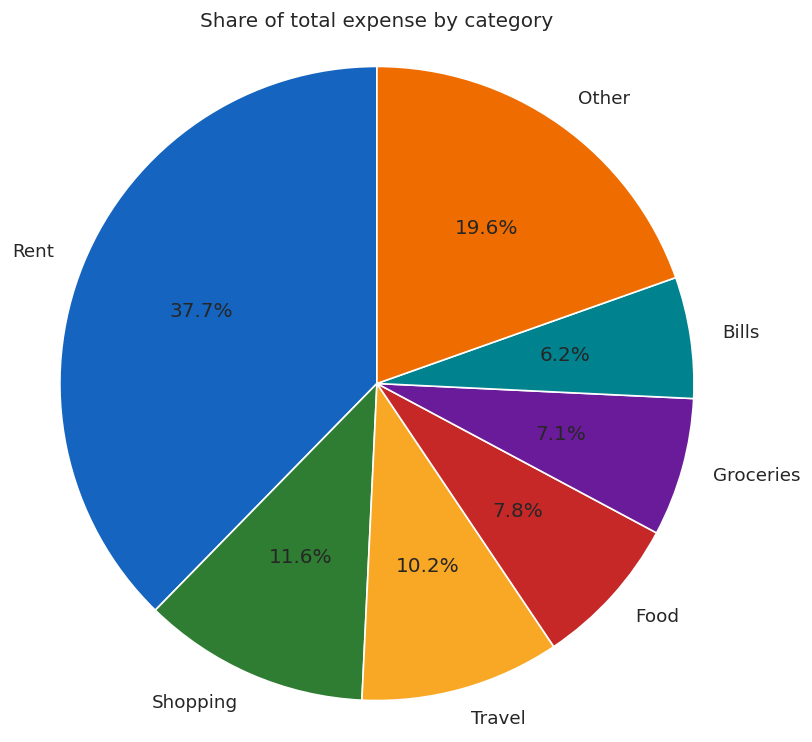
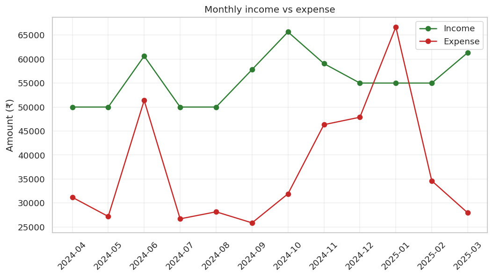
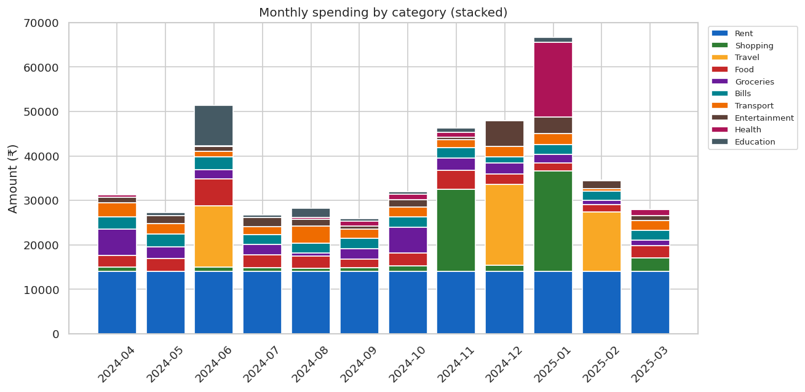
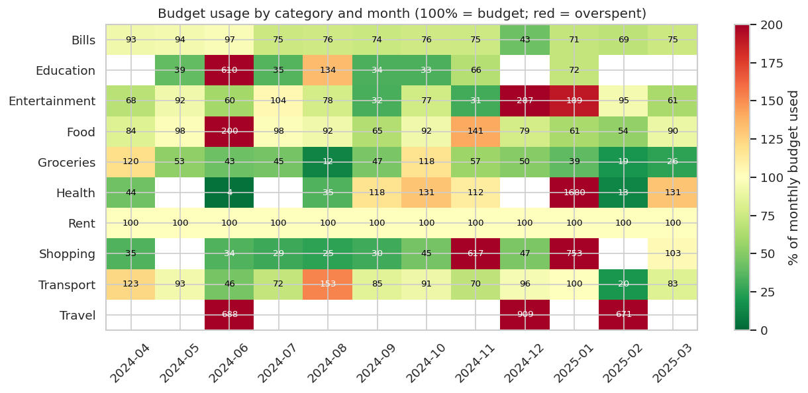
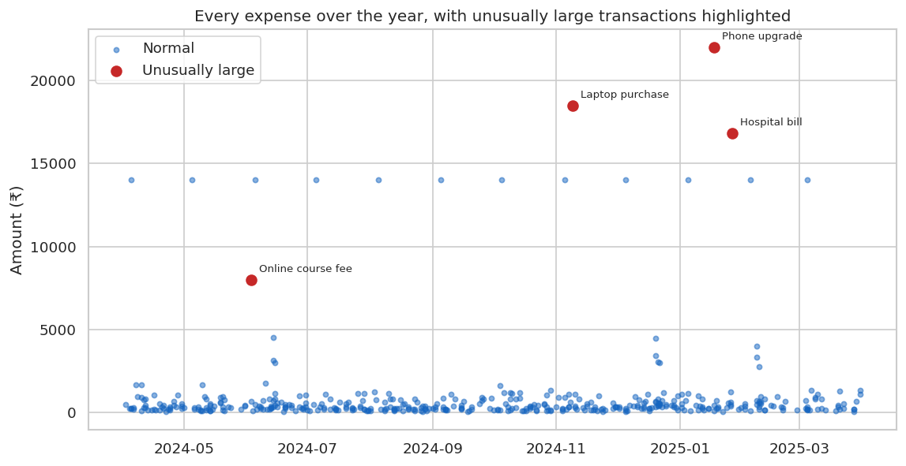
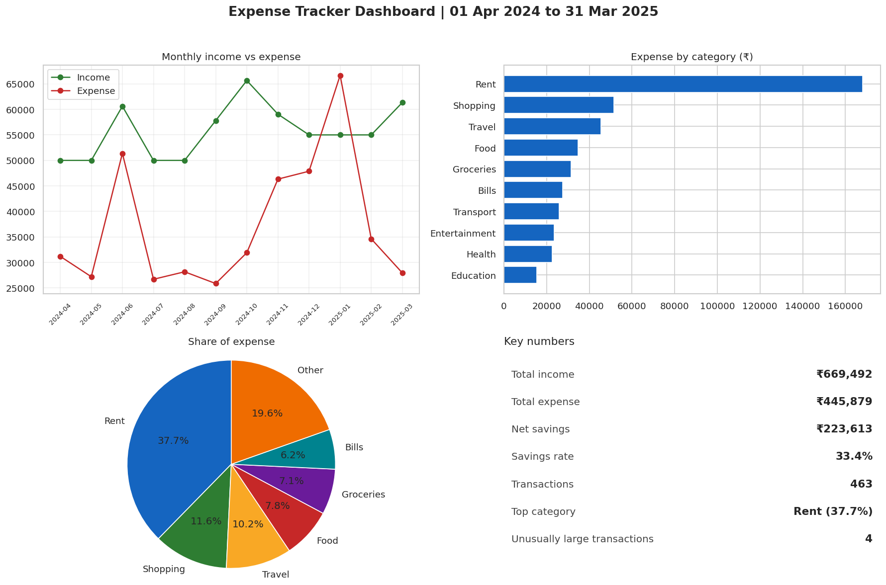

# Expense Tracker App using Data Science

A data science project that tracks, categorises and analyses personal expenses. It cleans messy transaction records, finds spending patterns, checks spending against monthly budgets, flags unusually large transactions, and writes plain-English insights.

The project uses **synthetic data** (a simulated year of transactions) because real financial data is private. Every number in this README comes from one clean run of the code in this repository.

---

## 1. Problem

Most people do not know where their money goes. Bank statements and payment apps are long lists of transactions, and a spreadsheet of them is hard to read. The questions people actually ask are:

- Where does my money go each month?
- Am I over budget, and in which category?
- Did something unusual happen, such as one large purchase?
- Am I saving enough?

## 2. Solution

The project takes a list of transactions and answers those questions automatically:

1. **Cleans** the data: fixes dates, amounts, category spelling and duplicates, and reports every fix.
2. **Analyses** spending by category, month, weekday and budget.
3. **Visualises** the results in eight charts and one dashboard.
4. **Explains** the results in plain English, with the 50/30/20 budgeting check.

## 3. Features

- Synthetic data generator that simulates a full financial year, with seasonal trends and one-off events
- Data cleaning with a report that counts every fix
- Feature engineering: month, weekday, weekend flag, income/expense sign, needs/wants group
- Category analysis: total, share, count, average and largest transaction
- Monthly trends: income, expense, savings and savings rate
- Budget check: spending against each category's monthly budget
- Weekday patterns: transactions and total spending by day
- Unusual transaction detection using the interquartile range (IQR) rule, within each category
- 50/30/20 budgeting check (needs, wants, savings)
- Eight charts and a dashboard, saved as PNG files
- Automatic insight sentences written from the numbers

## 4. Tech stack

The brief offered three options. This project uses **Option B** because it is the best balance for a student.

| Option | Tools | Interface | Difficulty | Used here? |
|---|---|---|---|---|
| A (Easy) | Excel or Google Sheets with pivot tables and built-in charts | Spreadsheet | Easy | No. Hard to version-control and repeat. |
| **B (Intermediate)** | **Python, pandas, NumPy, Matplotlib, Seaborn, Jupyter** | **Scripts, notebook, PNG charts** | **Intermediate** | **Yes** |
| C (Advanced) | Python plus Streamlit or Plotly, a SQL database, forecasting models | Interactive web dashboard | Advanced | Not yet. See section 13. |

Option B is chosen because it shows real data skills (cleaning, analysis, visualisation, automation) without the extra work of building and hosting a web app. The project is also easy to extend to Option C later.

Libraries: pandas, NumPy, Matplotlib, Seaborn. See `requirements.txt`.

## 5. Architecture

```
Input                    Storage            Processing                         Output
-----                    -------            ----------                         ------
Transactions             data/raw/          Cleaning (src/preprocessing.py)    Cleaned data  -> data/processed/
(date, category,    -->  expenses.csv  -->  Feature engineering                 Reports       -> outputs/
 amount, payment)                           (src/features.py)                  Charts        -> images/
                                            Analysis (src/analysis.py)         Insights      -> outputs/insights.txt
                                            Visualisation (src/visualize.py)
                                            Insights (src/insights.py)
```

**Workflow from the brief:** data input, then storage, then analysis, then visualisation, then insights, then decision-making. The last step is yours: the project shows where the money goes, and you decide what to change.

**Data flow in one paragraph.** The raw CSV is loaded as text so that every messy value is visible. Cleaning converts dates and amounts into proper types, standardises text, and removes duplicates, keeping a count of each fix. Feature engineering adds the month, weekday and needs/wants columns. The analysis functions summarise the cleaned data. The chart functions turn those summaries into PNG files, and the insight function turns the same numbers into sentences.

## 6. Project structure

```
Expense-Tracker-App/
├── data/
│   ├── raw/expenses.csv                 Messy synthetic transactions (created by the code)
│   └── processed/cleaned_expenses.csv   Clean transactions (created by main.py)
├── notebooks/
│   └── 01_EDA.ipynb                     Step-by-step analysis you can run cell by cell
├── src/                                 All the logic, one file per phase
│   ├── config.py                        Paths, budgets, categories and settings in one place
│   ├── data_generator.py                Simulates a year of expenses and adds messy data
│   ├── preprocessing.py                 Cleaning and the report of every fix
│   ├── features.py                      Month, weekday, weekend and needs/wants columns
│   ├── analysis.py                      Category, monthly, weekday, budget and anomaly analysis
│   ├── visualize.py                     All eight charts
│   └── insights.py                      Plain-English insight sentences
├── outputs/                             Reports created by main.py
│   ├── category_summary.csv             Spending per category
│   ├── monthly_summary.csv              Income, expense and savings per month
│   ├── weekday_summary.csv              Spending per weekday
│   ├── budget_check.csv                 Spending against budget per category and month
│   ├── unusual_transactions.csv         Transactions flagged as unusually large
│   ├── insights.txt                     The insight sentences
│   ├── cleaning_report.json             Count of every cleaning fix
│   ├── metrics.json                     Headline numbers
│   └── run_log.txt                      Terminal output of the last full run
├── images/                              Charts created by main.py (PNG)
├── screenshots/                         Proof screenshots: terminal, code, data and results
├── hardware/
│   └── esp32_expense_logger.ino         Optional ESP32 button logger (untested, see section 13)
├── main.py                              RUN THIS: executes every step in order
├── requirements.txt                     Libraries to install
├── INTERVIEW_PREP.md                    Interview questions, answers and explanations
└── .gitignore                           Files Git should ignore
```

**What each folder is for**

- `data/` holds the input (`raw`) and the cleaned output (`processed`). Keep the raw file unchanged, so you can always start again.
- `notebooks/` is for learning and exploring. It calls the same functions as `main.py`.
- `src/` holds the reusable code. Each file covers one phase of the project.
- `outputs/` holds the reports you can open in Excel or read as text.
- `images/` holds the charts. Use them in presentations and on your portfolio.
- `screenshots/` holds proof of the work, for GitHub and interviews.
- `hardware/` holds an optional extension that is not part of the main pipeline.

## 7. Installation

You need Python 3.9 or newer. The project was tested with Python 3.12.

**Mac / Linux**

```bash
cd Expense-Tracker-App
python3 -m venv .venv
source .venv/bin/activate
pip install -r requirements.txt
```

**Windows (PowerShell)**

```powershell
cd Expense-Tracker-App
python -m venv .venv
.venv\Scripts\activate
pip install -r requirements.txt
```

The virtual environment keeps this project's libraries separate from the rest of your computer. `(.venv)` at the start of the prompt means it is active.

## 8. How to run

From the project folder, with the virtual environment active:

```bash
python main.py        # Mac: python3 main.py
```

The program runs seven numbered steps, each with a banner, and ends with `DONE`.

**Expected output (from the run in this repository)**

| Step | What it does | Key output |
|---|---|---|
| 1 | Creates or loads the data | `Loaded 478 rows x 6 columns`, preview, missing values, messy category values |
| 2 | Cleans the data | `Exact duplicate rows removed: 6`, `Rows after cleaning: 463` |
| 3 | Adds features | Column count and a sample of the new columns |
| 4 | Analyses | Category totals, month-by-month table, 20 over-budget category-months, 4 unusual transactions, 50/30/20 check |
| 5 | Draws charts | Eight PNG files saved to `images/` |
| 6 | Writes insights | Eight sentences, saved to `outputs/insights.txt` |
| 7 | Saves reports | CSV, JSON and TXT files in `outputs/` |

To explore step by step, open the notebook:

```bash
python -m pip install jupyter
jupyter notebook notebooks/01_EDA.ipynb
```

## 9. Results

Results from one clean run. The random seed is fixed (42), so repeating the run gives the same numbers.

**Headline numbers, April 2024 to March 2025**

| Measure | Value |
|---|---|
| Total income | ₹669,492 |
| Total expense | ₹445,879 |
| Net savings | ₹223,613 |
| Savings rate | 33.4% |
| Transactions after cleaning | 463 |

**Spending by category**

| Category | Total (₹) | Share | Transactions |
|---|---|---|---|
| Rent | 168,000 | 37.7% | 12 |
| Shopping | 51,569 | 11.6% | 16 |
| Travel | 45,365 | 10.2% | 30 |
| Food | 34,654 | 7.8% | 104 |
| Groceries | 31,446 | 7.1% | 32 |
| Bills | 27,552 | 6.2% | 35 |
| Transport | 25,768 | 5.8% | 145 |
| Entertainment | 23,510 | 5.3% | 48 |
| Health | 22,670 | 5.1% | 13 |
| Education | 15,345 | 3.4% | 11 |

**Other findings**

- Spending was highest in **January 2025** (₹66,682) and lowest in **September 2024** (₹25,861).
- **20 of 102** category-months went more than 10% over budget. Health was over budget in 5 months, and Travel in 3.
- An average **weekend day costs ₹1,598**, compared with ₹1,072 on an average weekday, which is 1.5 times as much.
- **Four transactions were unusually large** for their category: a phone upgrade (₹22,000), a laptop (₹18,500), a hospital bill (₹16,800) and a course fee (₹8,000).
- The **50/30/20 check passes** on all three targets: needs 43.4% of income (target 50% or less), wants 23.2% (target 30% or less), savings 33.4% (target 20% or more).
- The average monthly expense in January to March 2025 was **17.7% higher** than in April to June 2024. The January figure includes two one-off purchases (the phone and the hospital bill), so the change is partly driven by those events.

The full text of the insights is in `outputs/insights.txt`.

## 10. Screenshots

**Raw data with messy values:**



**Terminal: loading and cleaning:**



**Cleaning code:**



**Category-wise spending:**



**Expense share (pie chart):**



**Monthly income vs expense:**



**Monthly spending by category (bar chart, stacked):**



**Budget usage heatmap:**



**Unusually large transactions:**



**Final result: HR-style dashboard for the expense data:**



**All other screenshots**

| File | What it shows |
|---|---|
| `screenshots/00_terminal_setup_check.png` | Python and library versions on the machine that ran the project |
| `screenshots/03_terminal_steps_3_to_4_analysis.png` | Feature engineering, category table, monthly table and weekday totals |
| `screenshots/04_terminal_steps_4_to_6_anomalies_insights.png` | Budget overspending, unusual transactions and the 50/30/20 check |
| `screenshots/05_terminal_steps_5_to_7_charts_insights_done.png` | Chart list, insight sentences and the final `DONE` banner |
| `screenshots/code_02_daily_spending_profiles.png` | The simulated spending rates by category and season |
| `screenshots/code_03_messy_data_injection.png` | The code that adds the messy data problems |
| `screenshots/code_04_budget_and_anomalies.png` | Budget check and the unusual-transaction rule |
| `screenshots/code_05_overspending_insights.png` | How the overspending insight is written from the numbers |
| `screenshots/code_06_main_analysis_step.png` | The analysis step in `main.py` |
| `screenshots/graph_05_weekday_activity.png` | Transactions and spending by weekday |

## 11. Simulation: how the data is made

Real financial data is private, so `src/data_generator.py` simulates one financial year. This is the step-by-step simulation:

1. **Fixed monthly items.** Salary arrives on the 1st (₹50,000, rising to ₹55,000 from October). Rent (₹14,000) is paid on the 5th. Electricity, internet and mobile bills follow, and electricity is higher in the hot months.
2. **Occasional income.** Freelance work pays about once every three months, between ₹4,000 and ₹12,000.
3. **Everyday spending, day by day.** Each day, the number of transactions in each category is drawn from a Poisson distribution. Food, transport and entertainment are more common at the weekend, and transport is more common on weekdays.
4. **Realistic amounts.** Each amount is drawn from a log-normal distribution. Most purchases are small, and a few are large. This is how real spending behaves.
5. **Trends.** October (festival season) raises food and shopping. December (holidays) raises entertainment and travel. These create the seasonal patterns in the charts.
6. **One-off events.** A course fee, a laptop, a phone, a hospital bill and three trips. These create the overspending and unusual-transaction cases.
7. **Messy data.** About 8% of dates are written as day/month/year, 3% of amounts have a rupee sign, 8% of categories have odd spelling, 3% of types are in capitals, and a few values are missing. Six rows are duplicated.
8. **Final output.** `data/raw/expenses.csv`: 478 rows, the messy file the cleaning step has to fix.

**How overspending is detected.** Each category has a monthly budget in `src/config.py`. For each category and month, the code compares the total spent with the budget. A category is flagged if it is more than 10% over (`OVERSPEND_TOLERANCE`).

**How an unusual transaction is detected.** Within each category, the code calculates the first and third quartiles (Q1 and Q3) and the interquartile range (IQR = Q3 − Q1). A transaction is flagged if its amount is above Q3 + 3 × IQR. This method is used because a few large values do not move the quartiles much, so the rule still works when the data has outliers.

**What the simulation can and cannot show.** It shows that the pipeline works and that the analysis finds the patterns that were built in. It cannot show how a real person spends. Section 13 covers the limitation.

## 12. Cleaning steps

The cleaning order is deliberate:

1. Load every column as text, so the messy values are visible.
2. Remove exact duplicate rows.
3. Drop rows missing a critical field (Date, Amount, Category or Type).
4. Convert dates (both `2024-04-15` and `15/04/2024` are accepted) and amounts (`₹1,250` becomes `1250`).
5. Standardise text: remove extra spaces, use Title Case for categories and types, and standardise payment method names.
6. Remove duplicates again, because some rows only match after standardising.
7. Count every fix in `outputs/cleaning_report.json`, so the numbers can be explained.

## 13. Limitations

- **Synthetic data.** The data is simulated, so the patterns are the ones that were built in. The numbers say nothing about a real person's spending.
- **Budgets are set by hand.** The budget values in `src/config.py` are examples. A real user would set their own.
- **No forecasting.** The project describes the past. It does not predict next month's spending. This is listed as a future improvement.
- **No interactive dashboard in this version.** The Streamlit dashboard is optional in the brief. It is not included here because Streamlit was not available in the environment where the project was built, so it could not be tested. Install Streamlit and add an `app.py` that reuses the functions in `src/` to build it.
- **Payment method is an addition.** The brief's CSV has five columns. This project adds `Payment_Method`, because the brief's architecture lists payment method as an input.
- **Seaborn is used for two charts only.** The other charts use Matplotlib directly.
- **The ESP32 sketch is untested.** It is included because the brief asks for it, but there was no ESP32 board to test it on. It prints to the Serial Monitor and does not write to the CSV.

## 14. Future improvements

- A mobile app for entering expenses on the go
- Real-time tracking, for example by connecting to a bank or payment app export
- AI-based spending forecasts for the next month
- Budget alerts, for example an email or notification when a category is 80% used
- Financial goal tracking, for example saving ₹1,00,000 for a laptop by a set date
- The Streamlit dashboard, using the existing functions in `src/`

## 15. Upload to GitHub

**Suggested repository details**

- **Repository name:** `Expense-Tracker-App`
- **Description:** A data science project that cleans, analyses and visualises personal expenses, with budget checks, unusual-transaction detection and automatic insights, using synthetic data.
- **Topics:** `data-science`, `python`, `pandas`, `matplotlib`, `seaborn`, `personal-finance`, `expense-tracker`, `data-analysis`, `budgeting`, `synthetic-data`

**Commands** (run inside the project folder, after installing Git and creating an empty repository on GitHub):

```bash
git init
git add .
git commit -m "Initial commit: expense tracker with synthetic data, cleaning and analysis"
git branch -M main
git remote add origin https://github.com/<your-username>/Expense-Tracker-App.git
git push -u origin main
```

**Commit messages for the proof-of-work timeline**

| Day | Suggested commit message |
|---|---|
| 1 | `Set up project structure and requirements` |
| 2 | `Add synthetic expense generator and messy-data handling` |
| 3 | `Add cleaning, feature engineering and category analysis` |
| 4 | `Add monthly trends, budget check and unusual-transaction detection` |
| 5 | `Add charts, dashboard, insights and screenshots` |

Only make commits for work you actually did on those days.

## 16. Troubleshooting

| Problem | Fix |
|---|---|
| `python` is not recognised (Windows) | Reinstall Python and tick **Add python.exe to PATH**, or use `py` instead of `python`. |
| Activation is blocked in PowerShell | Run `Set-ExecutionPolicy -Scope CurrentUser RemoteSigned` once, then activate again. |
| `ModuleNotFoundError: No module named 'src'` | Run `python main.py` from the project folder, not from inside `src/`. |
| `ModuleNotFoundError: No module named 'seaborn'` | The virtual environment is not active, or the install did not finish. Activate it and run `pip install -r requirements.txt`. |
| `₹` looks like a box in a chart | The font on your computer lacks the rupee sign. The charts still show the correct numbers. Use another font in `src/visualize.py` if needed. |
| Results differ from this README | Check library versions with `pip list`. The seed is fixed, so the data is the same on every run. |
| Want a fresh dataset | Delete `data/raw/expenses.csv` and run `python main.py` again. |
